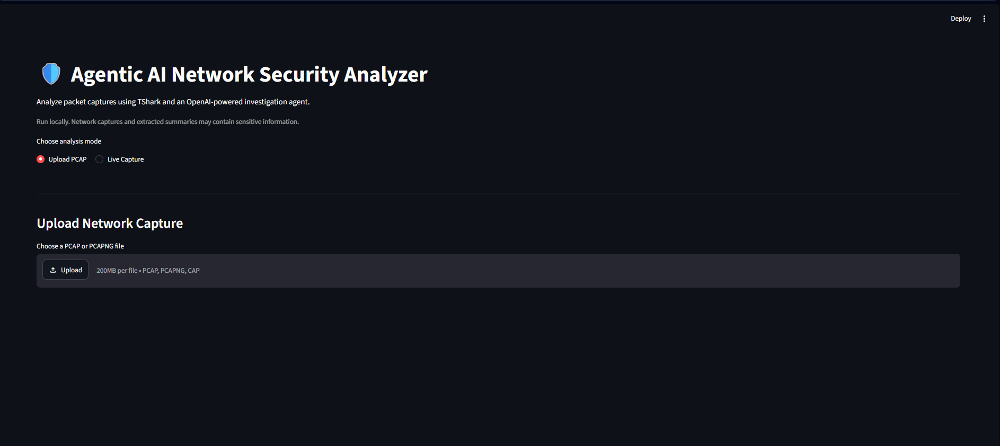

# 🛡️ Agentic AI Network Security Analyzer

An agentic AI system that automates network traffic analysis using **TShark, Python, and OpenAI**. The AI agent can independently select security analysis tools, investigate suspicious network activity, and generate evidence-based security reports.

## 🌐 Web Application

The project includes a Streamlit web interface that supports both PCAP file uploads and live network traffic capture.



## Overview

Network traffic analysis is an important part of cybersecurity. Security analysts often use Wireshark to manually inspect packets, apply filters, identify suspicious hosts, and investigate unusual network behavior.

However, analyzing large amounts of network traffic manually can be time-consuming.

This project explores how agentic AI can automate part of that workflow.

The system uses **TShark**, the command-line version of Wireshark, to extract network information. An AI agent powered by the OpenAI API can choose from a set of predefined Python/TShark analysis tools based on the evidence it receives.

Instead of simply following a fixed sequence of checks, the agent can examine results, decide what to investigate next, and generate a final security report.

## Main Features

- **PCAP/PCAPNG Analysis:** Upload existing network packet capture files for automated analysis.
- **Live Network Capture:** Capture network traffic directly through TShark using an authorized network interface.
- **TCP SYN Analysis:** Summarize TCP connection attempts, source IPs, destination IPs, and ports.
- **DNS Analysis:** Examine DNS queries and identify unusually long domain names for further investigation.
- **Port Scan Detection:** Identify possible broad TCP port-scanning activity.
- **TCP Flag Analysis:** Examine SYN, SYN-ACK, ACK-only, FIN, and RST packet patterns.
- **IP Investigation:** Investigate individual IPv4 addresses and their network activity.
- **Agentic AI Investigation:** Allow the AI agent to select appropriate analysis tools and perform multi-step investigations.
- **Security Report Generation:** Generate reports containing findings, supporting evidence, risk assessments, and recommendations.
- **Streamlit Dashboard:** Provide a web interface for uploading captures, starting live captures, viewing investigation results, and downloading reports.
- **Automatic Report Saving:** Save generated security reports in the project's reports directory.

## System Architecture

The overall workflow is:

```text
             Streamlit Application
                       |
              Select Input Mode
                 /         \
           Upload PCAP   Live Capture
                 \         /
                  PCAP File
                       |
                  AI Agent
                       |
              Selects Analysis Tool
                       |
                Python + TShark
                       |
                Network Evidence
                       |
                  AI Evaluates
                    Results
                       |
              Further Investigation?
                   /       \
                 Yes        No
                  |          |
             Select Tool   Final Report
                  |
             New Evidence
                  |
                AI Agent
```

## Agentic AI

The main feature of this project is the use of an AI agent that can select and execute predefined security analysis tools.

The agent is connected to the OpenAI API and has access to the following Python/TShark functions:

```python
get_syn_summary()
get_dns_summary()
get_tcp_flag_summary()
detect_port_scan()
detect_dns_anomalies()
investigate_ip()
```

The results from one tool can influence what the agent decides to investigate next.

For example:

```text
AI Agent
    |
    v
get_syn_summary()
    |
    v
Identifies an interesting source IP
    |
    v
investigate_ip()
    |
    v
Receives additional network evidence
    |
    v
AI evaluates the results
    |
    v
Selects further investigation if needed
    |
    v
Final Security Report
```

The AI does not have unrestricted command-line access. It can only use the predefined analysis functions provided by the application.

## Security Analysis Capabilities

### 1. TCP SYN Analysis

Examines TCP SYN connection attempts and provides:

- Total SYN attempts
- Unique destination IP addresses
- Unique destination ports
- Frequently contacted ports
- Most active source IP addresses

### 2. DNS Analysis

Extracts DNS queries and identifies frequently requested domain names.

It also flags unusually long DNS names for further investigation. These findings are treated as potential anomalies rather than automatically classified as malicious.

### 3. Port Scan Detection

Examines source-destination pairs for attempts to connect to many different TCP destination ports.

The current implementation uses an initial threshold of 20 unique destination ports.

### 4. TCP Flag Analysis

Examines TCP flag patterns, including:

- SYN
- SYN-ACK
- ACK-only
- FIN
- RST

This allows the system to identify certain probing behaviors that may not be visible through SYN-based analysis alone.

### 5. Individual IP Investigation

Investigates a selected IPv4 address to obtain additional information about:

- Packets sent and received
- Contacted IP addresses
- Outbound TCP destination ports
- Outbound UDP destination ports
- TCP SYN connection activity

## Experimental Results

The system has been tested using normal network traffic, live captures, and publicly available Nmap sample captures.

| Test Capture | Traffic Type | Observed Agent Result |
|---|---|---|
| `normal.pcapng` | Normal browsing | No confirmed port scan |
| `nmap_standard_scan` | Standard Nmap scan | Broad port scan detected |
| `nmap_OS_scan` | Nmap OS/port scanning | Broad port scan detected |
| `nmap_ACK_scan_on_port_80` | ACK probing | ACK-only probing identified |
| `nmap_ACK_scan_on_port_80_2` | ACK probing | ACK-only probing identified |
| `nmap_zombie_scan` | Zombie/idle scan | Not specifically identified |
| Live network capture | Normal browsing and application traffic | No clear port scan identified |

The tests demonstrated that the system can identify broad TCP SYN scanning and recognize selected TCP flag patterns.

The zombie/idle scan test revealed a limitation: the current implementation does not provide enough flow-level analysis to identify this specific scanning technique.

These results represent functional tests on a limited set of captures, not a statistically validated detection accuracy measurement.

## Technologies Used

| Technology | Purpose |
|---|---|
| Python | Application and security analysis logic |
| Wireshark / TShark | Packet capture and network analysis |
| OpenAI API | AI reasoning and tool selection |
| Streamlit | Interactive web application |
| PCAP / PCAPNG | Network packet capture formats |
| JSON | Structured analysis results |
| Git / GitHub | Source code management |

## Project Structure

```text
ai-tshark-agent/
|
|-- app.py
|-- README.md
|-- .gitignore
|
|-- captures/
|   |-- nmap_standard_scan
|   |-- nmap_OS_scan
|   |-- nmap_ACK_scan_on_port_80
|   |-- nmap_ACK_scan_on_port_80_2
|   |-- nmap_zombie_scan
|   |
|   `-- (Personal and live captures excluded from Git)
|
|-- reports/
|   `-- (Generated reports excluded from Git)
|
`-- src/
    |-- ai_agent.py
    |-- tshark_tools.py
    |-- live_capture.py
    |-- agent.py
    |-- rule_agent.py
    `-- openai_test.py
```

## Installation and Requirements

The project requires:

- Python 3
- Wireshark / TShark
- OpenAI API key
- OpenAI Python library
- Streamlit

### 1. Clone the repository

```bash
git clone https://github.com/SamudithaD97/ai-tshark-agent.git
```

Navigate into the project directory:

```bash
cd ai-tshark-agent
```

### 2. Install Python dependencies

```bash
python -m pip install openai streamlit
```

### 3. Install Wireshark and TShark

Download Wireshark from:

https://www.wireshark.org/download.html

Ensure that TShark is installed and available in the system PATH.

Verify the installation:

```bash
tshark --version
```

### 4. Configure the OpenAI API key

The OpenAI API key must be stored as an environment variable.

On Windows Command Prompt:

```cmd
setx OPENAI_API_KEY "YOUR_API_KEY"
```

Close and reopen the terminal after setting the variable.

Do not place API keys directly in the Python source code or commit them to GitHub.

## Running the Project

### Option 1: Run the AI Agent from the Terminal

From the project directory:

```bash
python src/ai_agent.py
```

By default, the system analyzes the configured default PCAP file.

To analyze a different capture on Windows Command Prompt:

```cmd
set PCAP_FILE=captures\nmap_standard_scan
python src\ai_agent.py
```

For an OS scan capture:

```cmd
set PCAP_FILE=captures\nmap_OS_scan
python src\ai_agent.py
```

In PowerShell, use:

```powershell
$env:PCAP_FILE = "captures\nmap_standard_scan"
python src\ai_agent.py
```

### Option 2: Run the Streamlit Web Application

Start the web application with:

```bash
python -m streamlit run app.py
```

Open the local application in your browser:

http://localhost:8501

The application provides two analysis modes:

**Upload PCAP**

Select an existing PCAP or PCAPNG file and click Analyze Traffic. The AI agent automatically investigates the selected capture.

**Live Capture**

Select an available network interface, choose a capture duration, and start live traffic capture. TShark saves the capture and passes it to the AI agent for analysis.

The application displays the investigation output and provides a downloadable security report.

## Security Considerations

The project follows several security principles:

- The AI agent does not receive unrestricted shell access.
- Only predefined security analysis functions are exposed to the AI.
- AI-generated IPv4 addresses are validated before being used in TShark filters.
- Network-derived information is treated as untrusted data.
- Unusual network activity is not automatically classified as malicious.
- Reports distinguish observations, suspicious indicators, and confirmed findings.
- API credentials are stored outside the source code.
- Personal and live packet captures are excluded from public GitHub commits.

## Limitations

This project is a prototype and does not detect every type of network attack.

Current limitations include:

- Heuristic-based port scan detection
- Limited flow-level analysis
- Basic DNS anomaly detection
- Incomplete recognition of advanced scanning techniques such as zombie/idle scans
- Evaluation using a limited number of packet captures
- Dependence on the information returned by the available analysis tools
- OpenAI API usage costs and external data-sharing considerations

The system is intended to assist network security investigation rather than replace a security analyst.

## Future Improvements

Possible improvements include:

- More advanced TCP scan detection techniques
- DNS tunneling and suspicious DNS behavior analysis
- Detailed flow and packet timing analysis
- Threat-intelligence integration
- Continuous live network monitoring
- Improved security report visualization
- Larger labeled PCAP evaluation datasets
- Local AI model support for sensitive network environments

---

**Developer:** SamudithaD97

**Repository:** https://github.com/SamudithaD97/ai-tshark-agent
